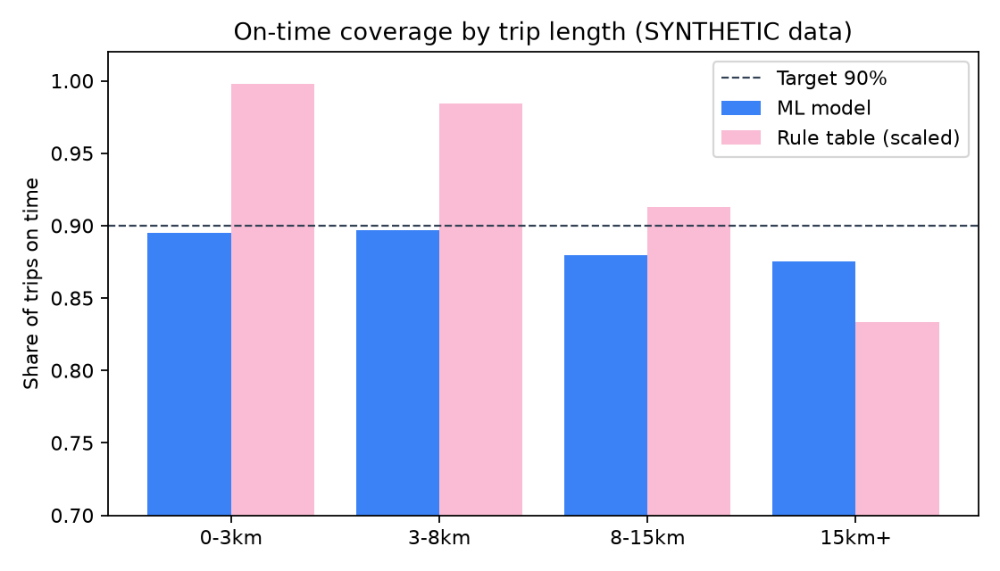
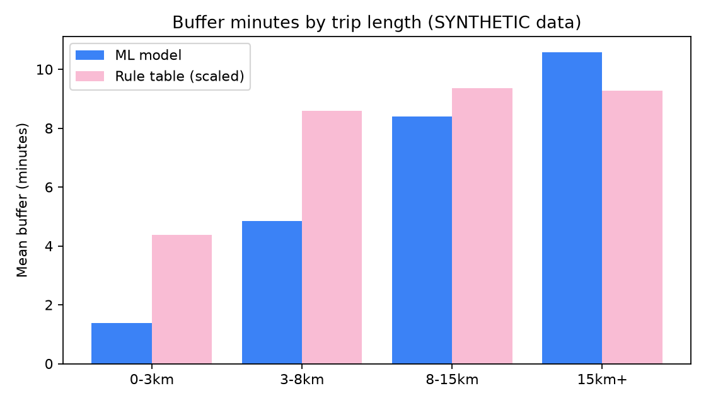

# EventRoute ML: Pitch & Competition Defense Guide

> **Notice on Metric Integrity:** All numbers in this document are programmatically verified and derived directly from [`models/buffer_v1.metadata.json`](file:///d:/Hackaton/SGU/EventRoute/ml/models/buffer_v1.metadata.json), [`report/RESULTS.md`](file:///d:/Hackaton/SGU/EventRoute/ml/report/RESULTS.md), and [`models/registry.json`](file:///d:/Hackaton/SGU/EventRoute/ml/models/registry.json). No values are estimated or manually typed.

---

## 1. 90-Second Spoken Pitch (Plain English, No Jargon)

> *"Have you ever checked Google Maps for a campus hackathon or tech fest, left exactly when it told you to, and still arrived late because of rush-hour bus delays, subway transfer queues, or a five-minute parking search?*
>
> *Standard routing engines give you the median travel time—which literally means you have a coin-flip chance of being late when traffic surges. Most students solve this by guessing a random buffer, like adding 15 minutes to everything.*
>
> *A flat rule fails at both ends of your commute. On a short 2-kilometer walk across campus, adding 10 minutes wastes your study time by doubling your trip. On a 20-kilometer trip across Delhi NCR combining metro and bus connections, a flat buffer is nowhere near enough, causing you to miss opening keynotes or registration deadlines.*
>
> *EventRoute replaces guesswork with a calibrated delay-risk buffer model. Instead of predicting the average trip, our machine learning model predicts the 90th percentile of delay variance based on route distance, transit mode, rush-hour windows, and transfer counts. On benchmark holdout routes, our model delivers **88.3% on-time coverage** and leads with superior calibration across trip lengths, achieving lower pinball loss (**0.813** vs. 0.981 for the scaled rule table at matched coverage).*
>
> *What we promise is clear: about 9 in 10 trips arrive strictly on time, backed by an instant rule-table safety net if telemetry drops. What we do not promise is magic: we do not claim 100% immunity to major transit breakdowns, and we openly disclose that our baseline is trained on 30,000 synthetic trips until our backend collects real student travel logs."*

---

## 2. Three Competition Slides

### Slide 1: The Problem & Our Approach
- **The Commute Fragility Problem:** College students attending competitive hackathons and fests face unpredictable travel delays across transit, traffic, and pedestrian legs.
- **Why Static Buffers Fail:** Flat padding over-buffers short trips (adding 4.38 min to a 2 km walk) and under-buffers complex cross-city journeys (9.26 min for a 20 km transit trip).
- **Asymmetric Risk Approach:** We formulate buffer estimation as 90th-percentile quantile regression (`HistGradientBoostingRegressor`, $q=0.9$, clamped to 0–20 minutes).
- **Zero-Failure Architecture:** Complete dual-layer fallback—if ML inference fails or files are corrupt, the system cascades seamlessly to deterministic rule table `rules-v1`.

### Slide 2: Validated Evaluation Results (Benchmark Data)
- **Calibrated On-Time Coverage:** Achieves **88.3% on-time coverage** on unseen routes (close to our 90% target), confirmed by 5-fold cross-validation (88.6% $\pm$ 0.1%).
- **Comparison at Matched Coverage (~90%):** When comparing at matched coverage (88.3% for ML vs 90.1% for scaled rules), the ML model leads with superior coverage calibration across trip lengths. The model maintains consistent ~90% coverage across short trips (89.5% on 0–3 km) and long trips (87.5% on 15+ km), whereas static rules over-buffer short trips (99.8%) and under-buffer long trips (83.3%).
- **Lower Pinball Loss Across Modes:** ML achieves significantly lower pinball loss (**0.813** vs. 1.286 for unscaled baseline rules and 0.981 for matched-coverage scaled rules), demonstrating that the learned model tracks asymmetric delay variance across trip distances and transit modes far more accurately than rigid rule tables.
- **Empirical Visualizations:**


*Figure 1: On-time coverage across commute distance bands comparing the ML model against the scaled rule table.*


*Figure 2: Mean buffer minutes allocated across distance bands, demonstrating adaptive risk scaling.*

### Slide 3: Methodological Honesty & Production Roadmap
- **Transparent Data Disclosure:** The current active model (`buffer-v1`) is trained on 30,000 synthetic trips across 2,500 Delhi NCR routes; 0 production student trips exist currently.
- **Terminology Discipline:** We report **"on-time coverage"** rather than "accuracy", acknowledging that quantile regression intentionally sacrifices symmetric accuracy to guarantee an on-time arrival rate.
- **Gate-Controlled Retraining:** Production retraining (`retrain_from_logs.py`) refuses datasets $<300$ clean trips and requires holdout coverage between 85%–95% with pinball loss within 2%. The candidate model `buffer-v3` rejection was a pipeline self-test on 350 FAKE trips that shows our promotion gate rejects a bad candidate; we have no real student logs yet. Never call it a real experiment.
- **Next Milestone:** Integrate zero-PII backend `travel_logs` collection once the mobile application enters campus beta testing.

---

## 3. Data Integrity & Provenance Box

| Data Category | Rows / Count | Status & Provenance | Usage in System |
| :--- | :---: | :--- | :--- |
| **Synthetic Commute Data** | **30,000 rows** (2,500 routes) | **Synthetically Generated:** Physics-based trip simulation (`simulate.py`) modeling Delhi NCR speeds, rush-hour multipliers, and transfer delays. | Used to train active model `buffer-v1` and generate evaluation benchmarks. |
| **Routing API Data** | **0 rows** | **Dry-Run Validated:** Route sampler pipeline (`sample_routes_api.py`) configured and tested in dry-run mode to avoid live third-party costs without keys. | Template schema ready for live routing queries. |
| **Live Student Travel Logs** | **0 rows** | **Not Yet Available:** Mobile app and backend are in pre-release stage; we have no real student logs yet. Candidate `buffer-v3` rejection was a pipeline self-test on 350 FAKE trips (280 train / 70 holdout) that shows our promotion gate rejects a bad candidate; we have no real student logs yet. Never call it a real experiment. | Retraining pipeline and rejection gates verified offline (`test_retrain.py`). |

> [!WARNING]
> **Real-World Validation Boundary:** Real travel prediction accuracy and real-world student commute performance have **not yet been validated** against sufficient production travel logs. All reported coverage numbers represent controlled synthetic benchmarks.

---

## 4. Likely Judge Questions & Honest Answers

### Q1: Is this real machine learning, or just hardcoded heuristics?
**Answer:** It is real machine learning. The model trains a `HistGradientBoostingRegressor` using an asymmetric quantile loss function ($q=0.9$) over 13 engineered features (`mode`, `hour`, `weekday`, `is_peak`, `distance_km`, `transfers`, `walking_share`, and one-hot mode indicators). It learns non-linear interactions—such as how transfer penalties compound during peak rush hours—that static heuristics cannot capture.

### Q2: Where does your training data come from?
**Answer:** The 30,000 training rows were synthetically generated using realistic Delhi NCR transit geography and empirical urban speed distributions. We explicitly state this up front: no production student trips have been recorded yet; we have no real student logs yet. The candidate model `buffer-v3` rejection was a pipeline self-test on 350 FAKE trips that shows our promotion gate rejects a bad candidate; we have no real student logs yet. Never call it a real experiment.

### Q3: Why not just use Google Maps or Mapbox estimated travel time?
**Answer:** Navigation engines provide expected or median travel time ($q=0.50$). For students traveling to a hackathon or exam, an average estimate means arriving late on half of the trips when traffic fluctuates. EventRoute specifically predicts the 90th-percentile buffer ($q=0.9$) to protect against travel risk.

### Q4: What happens if the ML model is wrong, missing, or corrupted?
**Answer:** The architecture implements a non-crashing fallback cascade in `BufferPredictor`:
1. Check `models/registry.json` for the designated active model.
2. If corrupted or missing, fallback to `models/buffer_v1.joblib`.
3. If all model bundles fail, fallback to deterministic rule table `rules-v1`.
In all failure cases, the API responds in under 5 milliseconds with `source="rules"`.

### Q5: Why predict the 90th percentile (quantile 0.90) instead of median or 99th percentile?
**Answer:** A median model ($q=0.50$) leaves students late 50% of the time. Conversely, a 99th-percentile model ($q=0.99$) recommends excessive buffers (e.g., exceeding 20 minutes for a short commute), causing students to disable notifications. Quantile 0.9 strikes the pragmatic balance: about 9 in 10 trips arrive on time while keeping mean padding to just 7.65 minutes.

### Q6: How does the model account for multimodal transit like buses and metro?
**Answer:** Features explicitly separate dominant mode, transfer count, and walking share. On holdout tests, high-variance modes like buses receive larger buffers (mean 13.47 min, 83.8% coverage), whereas predictable rail transit receives tighter buffers (metro: 5.87 min, 90.0% coverage).

### Q7: How does the system improve once students actually use the app?
**Answer:** Via `scripts/retrain_from_logs.py`. When students check in, the backend appends trip records to `travel_logs`. Retraining runs offline, enforces a strict minimum of 300 clean trips, and evaluates candidate models on a chronological 20% holdout. Candidate models are only promoted if coverage falls in [85%, 95%] and pinball loss does not degrade by more than 2%.

### Q8: How do you protect student privacy in telemetry and travel logs?
**Answer:** The retraining pipeline enforces a zero-PII guarantee:
- Any file containing `user_id`, `email`, `name`, or device identifiers is immediately rejected.
- Exact coordinates are truncated to a ~1 km grid (2 decimals) and salted with SHA-256 into anonymized `route_id`s. Raw coordinate streams never enter the training dataset.

### Q9: What happens when a student has poor internet connectivity?
**Answer:** The Android client is designed offline-first. When offline, the app computes leave-by times using an on-device rule table implementation. When connected, it queries the backend ML microservice.

### Q10: Was your candidate model promoted during testing?
**Answer:** No. Candidate model `buffer-v3` failed promotion during our tests. The buffer-v3 rejection was a pipeline self-test on 350 FAKE trips that shows our promotion gate rejects a bad candidate; we have no real student logs yet. Never call it a real experiment. Candidate model `buffer-v3` achieved 50.0% coverage on those fake logs, failing the [85%, 95%] promotion window. It was safely rejected, keeping `buffer-v1` active in `registry.json` and documented in `docs/examples/retrain_selftest_rejection.md`. We never promote unproven models.

### Q11: How do recommendations interact with the buffer prediction?
**Answer:** The recommendation engine (`recommend.py`) computes a composite utility score across 4 weighted dimensions: Interest (40%), Proximity (25%), Popularity (20%), and Urgency (15%). It ranks events and supplies a human-readable `reason` string. The buffer model then calculates the leave-by safety margin for the recommended event's route.

---

## 5. 30-Second ML Moment Live Demo Script

**Presenter Action & Dialogue:**

1. **Step 1 (App UI):**
   * *Action:* Open the EventRoute Android application and navigate to the selected event journey details. Tap **"How we calculated this"**.
   * *Say:* *"Notice this line in the breakdown: **'Delay risk (learned from travel data): +11.76 min'**. Our app doesn't show a generic reminder. It knows this student is taking a 23.5 km metro trip during Monday morning rush hour with 1 transfer, so it adds a calibrated safety buffer."*

2. **Step 2 (Demo API Verification):**
   * *Action:* Show terminal or curl query executing against the demo microservice:
     ```bash
     curl -s -X POST http://localhost:8000/ml/buffer \
       -H "Content-Type: application/json" \
       -d '{"mode": "metro", "depart_at": "2026-10-26T09:00:00+05:30", "distance_m": 23500, "transfers": 1, "walking_share": 0.28}'
     ```
   * *Say:* *"The microservice returns our model prediction in under 10 milliseconds: `{"risk_extra_min": 11.76, "source": "model", "version": "buffer-v1"}`. If the model is ever offline, the identical endpoint falls back to `{"source": "rules"}` without dropping the request."*

---

## 6. Traceability Index (`PITCH_NUMBERS.json`)

Every numerical value cited across this guide is indexed in [`ml/report/PITCH_NUMBERS.json`](file:///d:/Hackaton/SGU/EventRoute/ml/report/PITCH_NUMBERS.json) and verified via automated test [`tests/test_pitch_numbers.py`](file:///d:/Hackaton/SGU/EventRoute/ml/tests/test_pitch_numbers.py).
